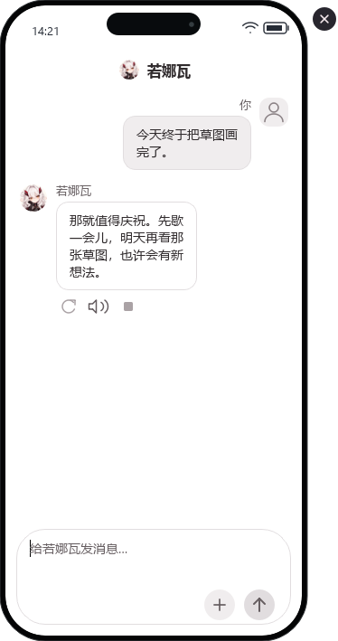
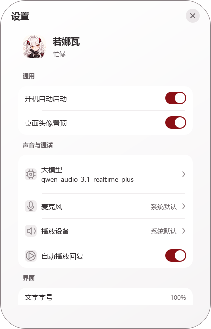

# Ronova-desktop-assistant

若娜瓦桌面助手是一个面向 Windows 的个人桌面应用。桌面头像提供陪伴聊天、Codex 工作区、截图、桌面整理和设置入口。鼠标悬停可展开菜单，左键点击头像可短暂查看 CPU 占用率、GPU 占用率及温度、系统内存占用。符合采集条件时也会显示游戏帧率。

[下载 Windows 运行包](https://github.com/LMHaruna/Ronova-desktop-assistant/releases) · [快速开始](#快速开始) · [从源码维护](#从源码维护)


## 快速开始

### v0.2.1 在线安装

v0.2.1 发布后，在同一版本的 Releases 页面下载 `Ronova-Setup.exe`，双击选择安装目录。安装器会自动下载该版本的资源分卷、验证 SHA-256，再解压并配置随包的 Python 环境。下载中断后可重新使用同一安装目录续传。资源分卷由安装器读取，无需手动逐卷下载。[v0.2.1 发布页](https://github.com/LMHaruna/Ronova-desktop-assistant/releases/tag/v0.2.1)

### 已发布的 v0.2.0

1. 从发布页下载 `Ronova-0.2.0-Windows-x64-Offline.zip.001` 至 `.006` 和 `Join-Ronova-Parts.ps1`，放在同一目录。下载、合并、解压和准备环境建议预留至少 **45 GiB**。[GitHub v0.2.0 发布页](https://github.com/LMHaruna/Ronova-desktop-assistant/releases/tag/v0.2.0)
2. 在下载目录打开 PowerShell，执行下面的命令。校验成功后解压合并得到的 ZIP。

   ```powershell
   powershell -NoProfile -ExecutionPolicy Bypass -File .\Join-Ronova-Parts.ps1
   ```

3. 按 v0.2.0 发布包说明运行 `安装.cmd` 和 `Start-Client.cmd`。运行包含 Windows x64 CPython 3.11.17、离线依赖和模型，使用者无需另装 Python。GitHub 自动生成的源码压缩包只提供源码及仓库文件。
4. 陪伴聊天在「设置 → 大模型」配置自己的服务商 API Key。Codex 工作区使用本机已安装的 Codex 客户端或 CLI，并在同一页的 Codex 区域登录 ChatGPT。

当前开发源码使用 `Ronova.exe` 启动，首次运行时会用随包 Python 创建项目内环境。下面介绍当前源码的功能，已发布的 v0.2.0 可能采用较早的操作方式。

## 陪伴系统

- **聊天与通话** · 支持文字和麦克风输入、重播回复、语音通话及静态立绘通话。接听来电后才启用麦克风。文字模型与语音引擎可按设置组合。
- **长期记忆** · 自动提炼有效记忆，在设置中汇总为一段文字。可以用自然语言更正或删除记忆。关系、好感度与誓约在陪伴系统中管理。
- **主动回应** · 主动文字和主动来电可分别启用，默认为关闭。主动回应会结合近期对话，跳过已说过的内容。开启自动播放时可朗读主动文字。



| 功能 | 使用条件 |
| --- | --- |
| 陪伴对话 | 联网及所选服务商的 API Key。模型调用和记忆整理可能产生费用。 |
| 实时语音 | 千问实时 Plus 和 Flash 使用各自的服务配置。使用复刻音色需要账号有对应模型的音色权限。 |
| 文字模型的语音回复 | 可按支持情况选用本地 IndexTTS-2.5 或云端千问 TTS Next。本地合成可使用 NVIDIA CUDA 加速。 |
| 语音输入 | 麦克风和输出设备。客户端的中文语音识别在本机运行。 |

## Codex 工作区

在「若娜瓦加班区」选择项目目录和对话，可设置模型、推理强度、计划模式及命令审批方式。Codex 请求选择或补充信息时会弹出输入框。任务执行状态显示在回复下方，成功完成时桌面头像会提示。

- 将标题栏拖到屏幕右侧，可先查看吸附轮廓，松手后窗口占当前屏幕可用宽度的四分之一。点击侧边黑条收起或展开，向左拖动标题栏可恢复浮动窗口。
- 若本轮生成了预览图，下方预览会自动展开。点击回复中的本地图片预览链接也可打开对应图像。双击预览图可标记并将副本加入待发送附件。
- 支持麦克风转写、回复朗读、截图附件和上下文压缩。用户提交的工作区内容发给 Codex，陪伴记忆由本机的陪伴系统独立管理。
- 可在工作区查看自行添加的本机扩展，MCP 和 Skills 分别放在项目的 `Extensions/MCP` 和 `Extensions/Skills`。


## 截图与桌面整理

区域截图支持多选区，按空格保留选区并继续选择，按 Enter 确认。双击截图附件可使用画笔、文字、形状和橡皮标记，完成后图片会加入聊天草稿。


「桌面整理」在 Windows 桌面上创建可移动和调整大小的分区。可对原生桌面图标排序、跨分区拖动或移回桌面，退出桌面整理后恢复原生图标视图。


## 设置与本机数据

可从设置调整开机启动、头像置顶、设备、字体和主题。关闭窗口后客户端仍可在托盘运行，从托盘选择「退出」可结束程序。

项目内的 `data/` 保存陪伴聊天、记忆、来电与桌面整理配置。模型密钥由 Windows 用户级加密存储管理。分享源码或构建发布包时应使用示例配置，个人数据和本机扩展适合单独备份。



## 从源码维护

已有完整运行时的开发目录可通过 `维护工具.cmd` 检查环境或运行回归测试。修复依赖前先从系统托盘退出客户端。

```powershell
.\维护工具.cmd verify-runtime --quick
.\维护工具.cmd test
```

准备好模型、内置 Python、离线依赖和 PresentMon 后，可构建 Windows 离线发布目录。脚本按清单收集文件、构建启动 EXE 并写入校验清单。发布目录和压缩分卷通过 GitHub Releases 分发。

```powershell
.\scripts\run-python.cmd .\scripts\download_presentmon.py
.\scripts\run-python.cmd .\scripts\build_desktop_package.py .\dist\Ronova-Windows-x64-Offline
```

帧率显示依赖 Intel PresentMon。在识别到可采集的游戏时才显示游戏 FPS。部分 Windows 配置需要相应的性能日志权限。第三方组件、字体和语音模型适用其各自的许可。[第三方组件许可与声明](THIRD_PARTY_NOTICES.md)

如需构建在线安装 EXE，可先将校验过的离线 ZIP 放到稳定的 HTTPS 直链，再用 `scripts/build_online_installer.py` 生成安装器。v0.2.0 的正式分发方式为 GitHub Releases 分卷。
