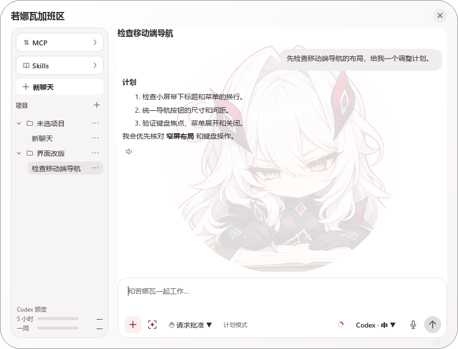
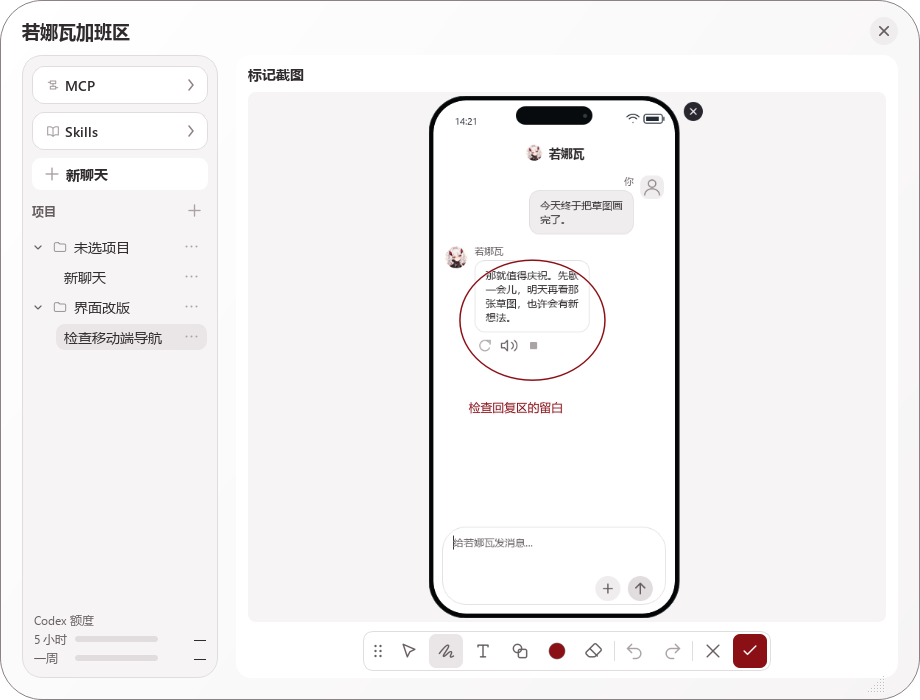
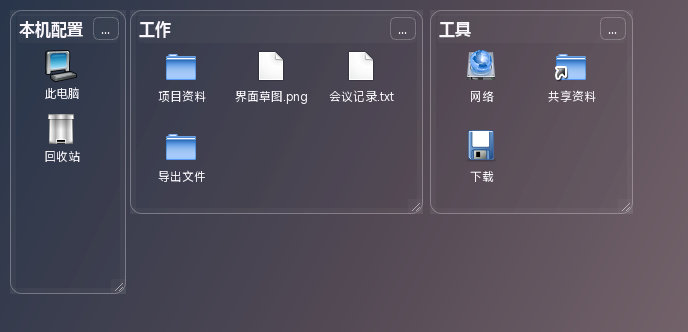

# 若娜瓦桌面助手 · Ronova AI Companion

Ronova 是一个以若娜瓦为角色的 Windows 桌面助手，提供文字聊天、语音与 Live2D 视频通话，也可以用来整理桌面、标注截图和通过 Codex 处理项目。启动后，鼠标悬停在桌面头像上即可展开功能入口。点击头像可短暂查看 CPU、GPU、内存和桌面合成帧率。

[下载 Windows 运行包](https://github.com/LMHaruna/ronova-ai-companion/releases) · [快速开始](#快速开始) · [维护与打包](#维护与打包)

### 桌面入口


### 陪伴手机


### 设置


界面图片使用演示数据和示例文件拍摄。

## 陪伴与通话

- **文字与语音聊天**：输入文字或用麦克风说话。可以重播回复，在通话中打断、静音或挂断。手机输入框发送键左侧的「＋」可打开语音通话、视频通话和誓约入口。
- **Live2D 视频通话**：视频窗口显示若娜瓦的 Live2D 形象，语音沿用选定的麦克风和播放设备。挂断后回到文字聊天，保留输入草稿。
- **角色知识与记忆**：本地知识库检索相关角色背景，作为陪伴回复的参考。可在「设置 → 记忆与关系」管理长期记忆和好感度。好感度达到 100 后可开启誓约，完成后可从同一入口重温。
- **主动文字与来电**：在「设置 → 主动回应」分别开启，两项默认关闭。开启后会额外调用模型。来电响铃时保持麦克风关闭，接听后才开始收音。

## 若娜瓦加班区

加班区通过本机 Codex 的 App Server 工作。首次使用时，在「设置 → 大模型」的 Codex 区域登录 ChatGPT。可以选择项目目录、按项目管理聊天，并选择 Codex 模型、推理强度和命令审批方式。工作区发送你提交的文字和选中的截图，陪伴聊天的角色设定与记忆留在陪伴系统。



- 输入框左下角的「＋」可压缩当前聊天的上下文，或切换计划模式。计划模式下 Codex 可以检查项目、提问并拟定方案，项目文件以只读方式访问。
- 可以用麦克风把问题转写到输入框，确认后再发送。完成的回复可点击语音图标朗读。
- 左侧可查看自行添加到项目 `Extensions/MCP` 和 `Extensions/Skills` 的扩展。

## 截图与桌面整理

从桌面头像或加班区打开「截图」，拖动框选。按空格保留当前选区并继续选下一张，按 Enter 确认。双击加班区的截图缩略图可用画笔、文字或形状标注，点底部的「✓」保存，再随消息一起发送。



「桌面整理」用分区收纳现有的 Windows 桌面图标。可以拖动标题移动分区、拖动边缘调整大小，或在框内滚动浏览。图标支持排序、跨框移动和移回桌面空白处，也可拖到回收站或 Windows 支持接收文件的应用图标。退出整理后恢复原生桌面图标视图。



## 快速开始

1. 在 64 位 Windows 上，从 [GitHub Releases](https://github.com/LMHaruna/ronova-ai-companion/releases) 的发布说明获取 Windows 运行包。新版运行包自带 **Windows x64 CPython 3.11.17**，无需另装 Python。GitHub 自动生成的 Source code 压缩包需要另行准备模型和运行依赖。
2. 将单文件 ZIP 解压到要安装的目录，双击 `安装.cmd`。安装程序会用随包的 Python 和离线依赖创建 `runtime/voice-venv`，完成后双击 `Start-Client.cmd` 启动。也可直接双击 `Start-Client.cmd`，首次启动时会自动安装依赖。解压后建议在同一磁盘额外留出至少 7 GiB 安装依赖，并为缓存和修复留出空间。
3. 打开「设置 → 大模型」，为陪伴聊天配置所选模型的 API Key。使用加班区时，另需本机可用的 Codex 客户端或 CLI，并在同一页登录 ChatGPT。

发布页若提供 `Ronova-Setup.exe`，可双击后选择空目录安装。在线安装器会下载并校验完整资源包，再使用随包 Python 安装依赖。安装 0.1.0 建议预留 32 GiB 空间，用于下载、解压和创建运行环境。需要填写链接的版本适合测试，发布版可内置下载地址。

### 模型、语音与设备

| 功能 | 所需条件 |
| --- | --- |
| 陪伴对话 | 联网和所选服务商的 API Key。客户端提供千问实时、DeepSeek 及兼容的文字模型配置。调用可能按服务商规则计费。 |
| 语音回复 | 千问实时模式直接接收云端语音。支持单独选择声音的文字模型可用本地 IndexTTS-2.5 或云端千问 TTS Next，云端音色需要账号权限。 |
| 本地语音合成 | IndexTTS-2.5 可用 NVIDIA CUDA 加速，显存以 8 GB 或以上作为参考。实际速度随硬件和所选模型变化。 |
| 语音输入与通话 | 麦克风和扬声器或耳机。中文语音识别在本机运行，使用前可在设置中选择输入、输出设备。 |

运行包包含语音模型、界面素材和离线依赖。缺少 Visual C++ 运行库时，可查看包内的 `runtime/prerequisites`。

## 维护与打包

双击 `维护工具.cmd`，可以修复 Python 环境、运行回归测试、检查运行环境。解压后的目录有 `package-manifest.json` 时，还可以在安装依赖前校验发布包。修复环境前请先从系统托盘退出 Ronova。

```powershell
.\维护工具.cmd verify-runtime --quick
.\维护工具.cmd test
```

开机自动启动、头像置顶和文字字号可在设置中调整。关闭窗口后程序仍驻留托盘，从托盘选择「退出」可停止客户端。如需移除，先关闭开机自动启动并退出程序，再删除项目目录。本机保存的模型密钥可单独从 `%LOCALAPPDATA%\Ronova` 清理 `client-models.bin`。

在包含模型、素材、基础 Python 和离线依赖的开发目录中，可生成 Windows 发布目录及校验清单，再压缩为发布包。发布目录包含 `runtime/python`，首次启动时会为目标电脑创建虚拟环境。

```powershell
.\scripts\run-python.cmd .\scripts\build_desktop_package.py .\dist\Ronova-Windows-x64-Offline
```

制作在线安装器时，将已校验的单文件 ZIP 上传到支持大文件的 HTTPS 下载服务，再用直链生成 EXE。

```powershell
.\scripts\run-python.cmd .\scripts\build_online_installer.py .\dist\Ronova-0.1.0-Windows-x64-Offline.zip .\dist\Ronova-Setup.exe --url 'https://downloads.example.com/ronova/0.1.0/Ronova-Windows-x64-Offline.zip'
```

省略 `--url` 可构建手动填写链接的测试版。安装器会校验 ZIP 的大小和 SHA-256。发布新版本时，把新 ZIP 上传到新的版本化地址，再用新地址构建并上传 EXE。保留旧地址可以让旧安装器继续使用。已安装的客户端仍通过用户主动下载新版更新。

这是个人兴趣项目，目前仍在开发。随包字体、语音组件与模型的许可见 [第三方组件许可与声明](THIRD_PARTY_NOTICES.md)。
